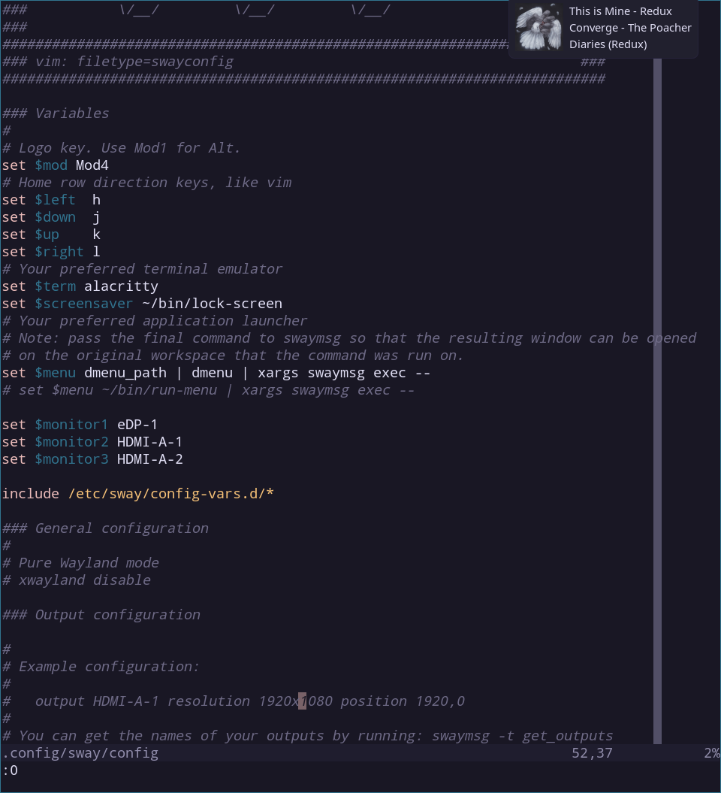
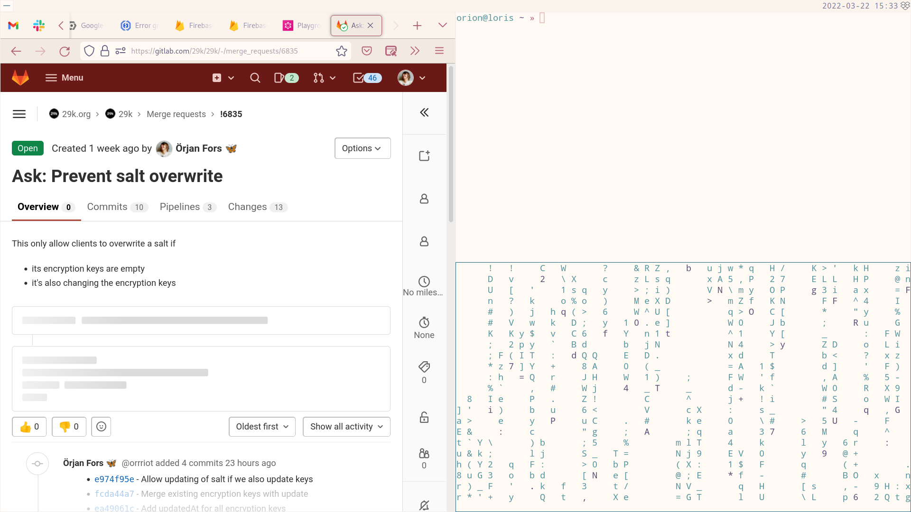

# dotfiles

Colors in [Rosé Pine](https://rosepinetheme.com/).




## Setup

```shell
git init --bare ~/.dotgit
alias dot='git --work-tree $HOME --git-dir $HOME/.dotgit'

# do not show untracked files
dot config status.showUntrackedFiles no

# track the remote, so push/pull/status work
dot remote add origin https://github.com/op/dotfiles.git
dot fetch origin

# restore files in ~ (main tracks origin/main)
dot checkout main

# install nix + packages (home-manager), then `mr checkout` (zplug etc)
~/.dotfiles/bootstrap.sh
```

Packages live in [`~/.config/home-manager/home.nix`](.config/home-manager/home.nix);
after editing, apply with `home-manager switch`. Update pinned versions with
`nix flake update --flake ~/.config/home-manager`.

### xdg directories

I keep my xdg home tidy.

```shell
ls ~
bin  doc  README.md  src  var
```

Migrate to [this xdg schema](.dotfiles/user-dirs.dirs), run:

```shell
python3 .dotfiles/xdg-setup.py
```

## Credits

Thanks for all the inspiration from loads of sources, including:

* [dln](https://github.com/dln/dotfiles)
* [lsjostro](http://github.com/lsjostro/dotfiles)
* [webcoyote](https://github.com/webcoyote/dotfiles)
